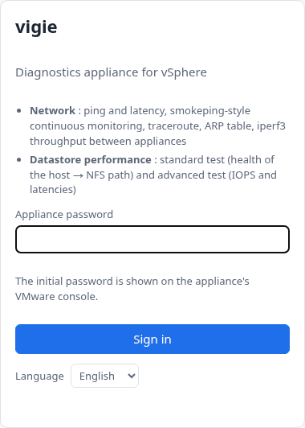

# Vigie documentation

Deployment, formats and release verification are covered in the [main README](../README.md). These
guides explain each feature of the appliance, with screenshots taken on a real vSphere 8 lab
(infrastructure names replaced by fictitious ones).

| Guide | Covers |
|---|---|
| [Datastore performance](datastore.md) | vSphere connection, test disk, standard and advanced tests, results, customer report, vMotion and host tour |
| [Monitoring and history](monitoring.md) | continuous monitoring, trends, job history, before/after comparison, CSV/JSON export |
| [Network diagnostics](network.md) | interfaces, ping, traceroute, continuous target monitoring, ARP table, iperf3 between appliances |
| [Settings](settings.md) | API tokens, report branding, verdict thresholds, about page |
| [Appliance console](console.md) | home screen, keyboard text interface, local mode without vCenter, network and password |
| [Other formats](formats.md) | live ISO, Proxmox, OpenStack (in French) |
| [Release notes](RELEASE-NOTES.md) | changes per version (in French) |

The web interface opens on `https://<appliance-ip>/` with the password shown on the VM console.

It is available in English, French, Spanish, Italian, Polish and German (selector at the top right),
with a light and a dark theme. Everything it shows is also available through the JSON API (see
[the README](../README.md#api)).
