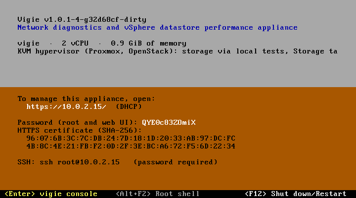
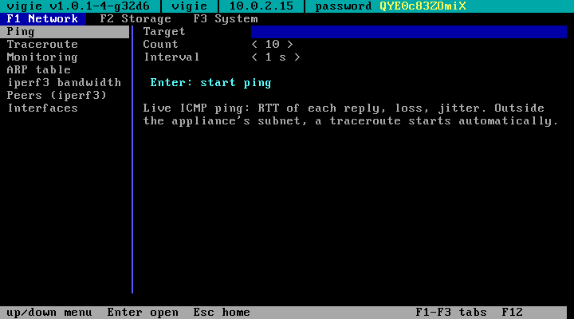
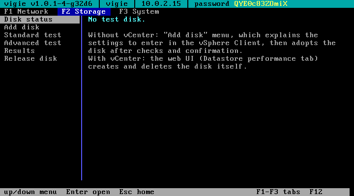
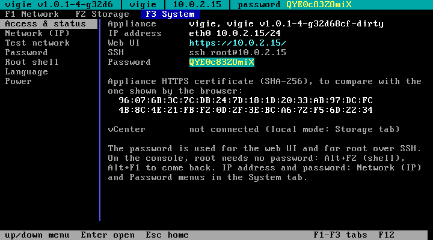

# Appliance console

The VM console (vSphere Client, Proxmox, or the screen of a physical machine booted from the ISO) is
driven with the keyboard only.

## Home screen

Always visible on the console: the web interface URL, the appliance password, the SHA-256
fingerprint of its HTTPS certificate (generated at first boot, unique to each appliance) and the SSH
command.

- **Enter** opens the text interface below.
- **Alt+F2** opens a root shell without password: access to the VM console is equivalent to physical
  access. **Alt+F1** comes back.
- **F12** shuts down or restarts the appliance.

## Text interface

Three tabs, **F1** to **F3**; arrows to move, **Enter** to open, **Esc** to go back.

### Network

Ping, traceroute, target monitoring, ARP table, iperf3 and peers, interfaces: the same tools as the
[web Network tab](network.md), usable before the network or the browser are even reachable.

### Storage

Storage tests **without vCenter**. **Add disk** explains which disk to add to the VM in the vSphere
Client (size, controller), then adopts it after three checks: the disk appeared after the request, it
is blank, and you type its name back. Standard and advanced local tests then run on it, without the
host counters. **Release disk** makes the appliance forget it; the appliance never removes or wipes
this disk, you detach it in vSphere.

With vCenter, use the web interface instead: it creates and deletes its own test disk.

### System

- **Access & status**: URL, SSH, password, certificate fingerprint, vCenter connection.
- **Network (IP)**: DHCP or static address, mask, gateway, DNS, host name.
- **Test network**: ping the gateway and the DNS servers (or other addresses), and resolve a name.
- **Password**: changes the password of the web interface and of root over SSH.
- **Language** of the console: English, French, Spanish, Italian, Polish or German (the web
  interface has its own selector).
- **Power**: shut down or restart.

Settings made on the console take precedence over the OVF properties and the cloud metadata.
