# Datastore performance

The **Datastore performance** tab measures an NFS datastore from the ESXi host the appliance runs on:
sequential throughput, latency, random IOPS, and the health of the network path between the host and
the NFS server. It is a series of numbered steps; each one unlocks the next.

## 1. vSphere connection

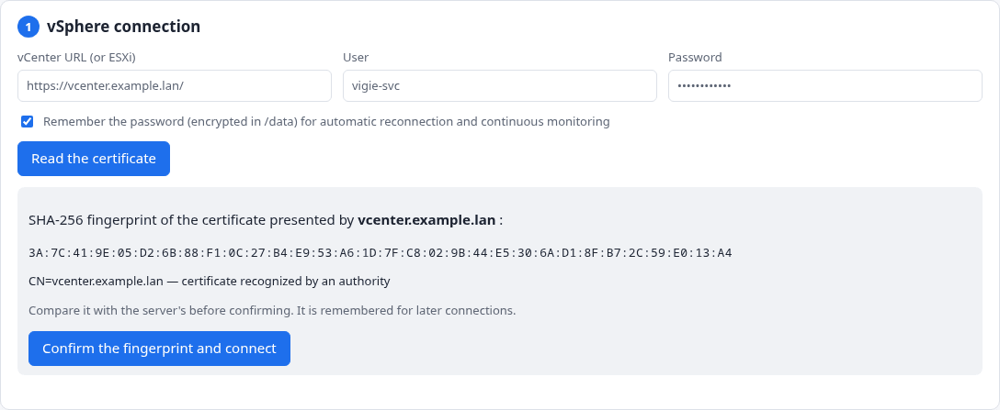

Enter the vCenter URL (a standalone ESXi also works, without vMotion), an account and its password,
then **Read the certificate**. The appliance shows the SHA-256 fingerprint of the certificate the
server actually presents, even when it is signed by a known authority: compare it with your vCenter
before confirming. The fingerprint is remembered for later connections.

**Remember the password** stores it encrypted on the appliance disk. It is needed for continuous
monitoring and for automatic reconnection after a restart of the appliance or of vCenter: the
appliance checks every 5 minutes that vCenter still recognises its session, and reconnects if not.
**Disconnect** forgets the password.

Everything goes through the vSphere API: the appliance never opens SSH to the ESXi hosts.

## 2. Self-identification

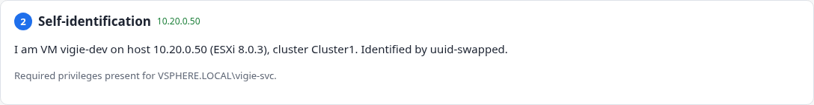

The appliance finds its own VM in the inventory (by SMBIOS UUID, or by MAC address as a fallback),
with its host and cluster. It then checks the account privileges and lists the missing ones, if any.

## 3. Datastore and NFS path

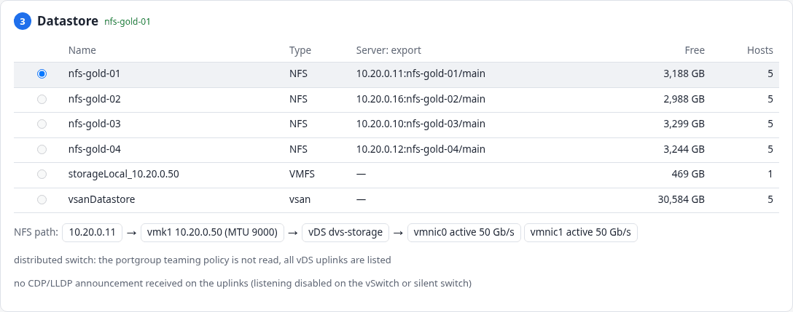

Pick the datastore to measure. For NFS, the appliance computes the path the host uses to reach the
server: NFS server → vmkernel interface (with its MTU) → standard or distributed switch → physical
uplinks with their speed. When the physical switch announces itself over CDP or LLDP, the switch name
and port appear next to each uplink; a note warns when the announced MTU is lower than the vmk MTU.

## 4. Test disk

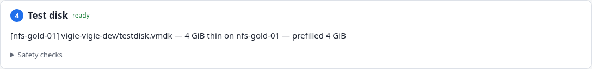

The appliance creates **its own** test disk (1 to 64 GB, thin, or thick eager zeroed when VAAI-NAS is
available) on the chosen datastore and attaches it to its VM. Before any write it checks that the
disk seen by Linux is exactly the one vSphere created (WWID, SCSI address, size, no partition, no
file system), then writes a signature on block 0. No other block device is ever written to.

On the first test the disk is prefilled with incompressible random data, so that reads hit real
data and not thin-provisioning holes.

## 5. Hosts: vMotion and tour

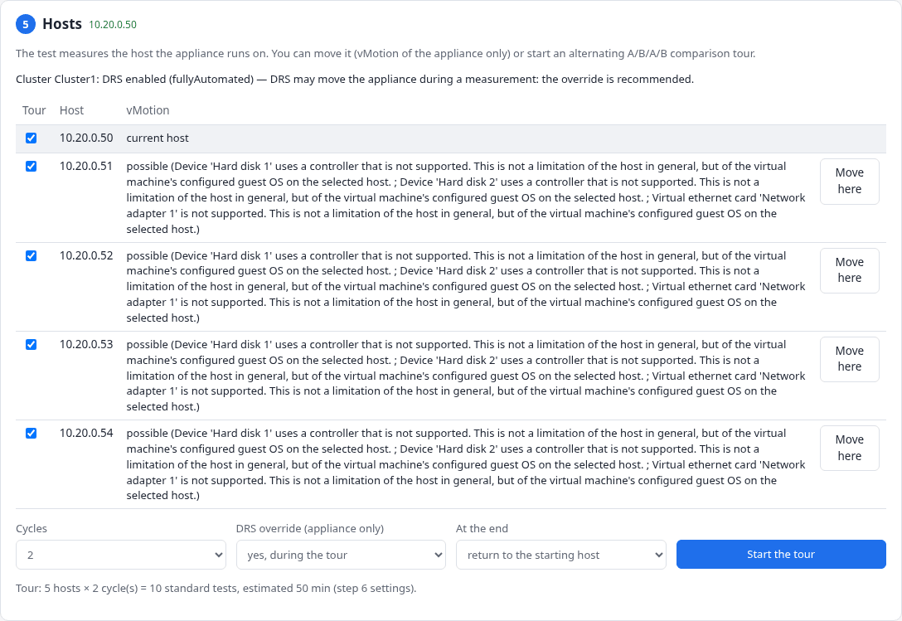

The appliance measures the host it runs on. This step lists the hosts that mount the datastore and
pre-validates a vMotion of the appliance to each of them.

- **Move here** migrates the appliance to that host (and only the appliance).
- A **tour** alternates the appliance between the selected hosts (A/B/A/B…), runs a standard test on
  each, and compares their write throughput. An optional DRS override (manual, on the appliance only)
  keeps DRS from moving it during a measurement; the original DRS setting is restored at the end.

## 6. Test type

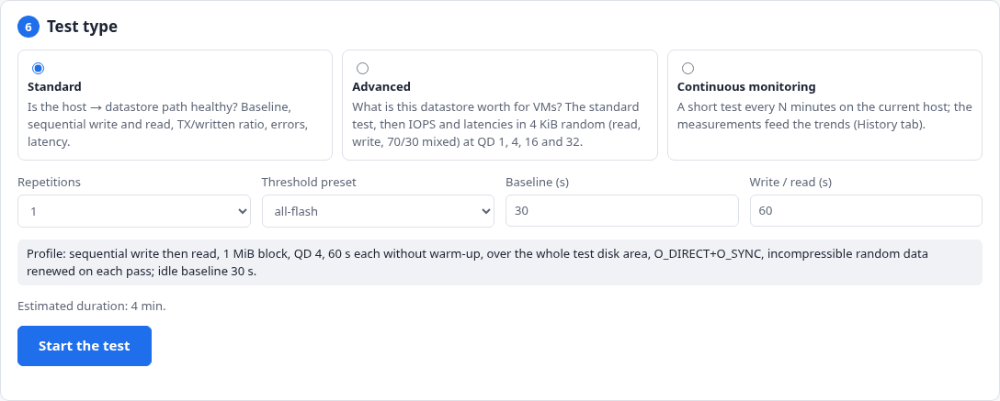

**Standard test**: an idle baseline, then sequential write and sequential read with 1 MiB blocks at
queue depth 4, O_DIRECT+O_SYNC. The profile line always shows the exact I/O profile, and the estimate
gives the expected duration. One or three repetitions (median of three).

Durations matter: vSphere counters are 20-second samples, so the TX/written ratio needs at least three
complete samples, which means at least 60 s of writing (80 s recommended).

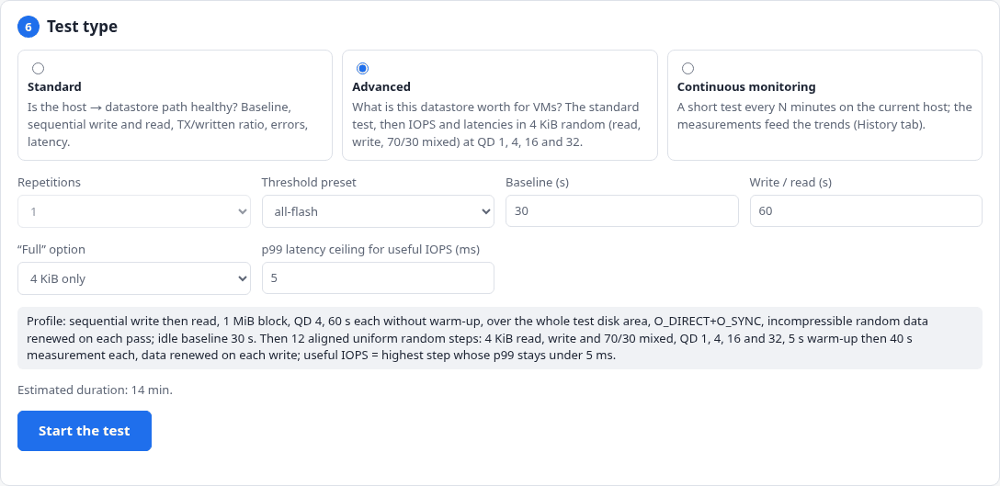

**Advanced test**: the standard test, followed by a random I/O matrix: 4 KiB read, write and 70/30
mixed, at queue depths 1, 4, 16 and 32 (5 s warm-up, 40 s measurement per step). The *full* variant
adds 8 and 64 KiB blocks. The **latency ceiling** defines *useful IOPS*: the highest step whose p99
latency stays under it.

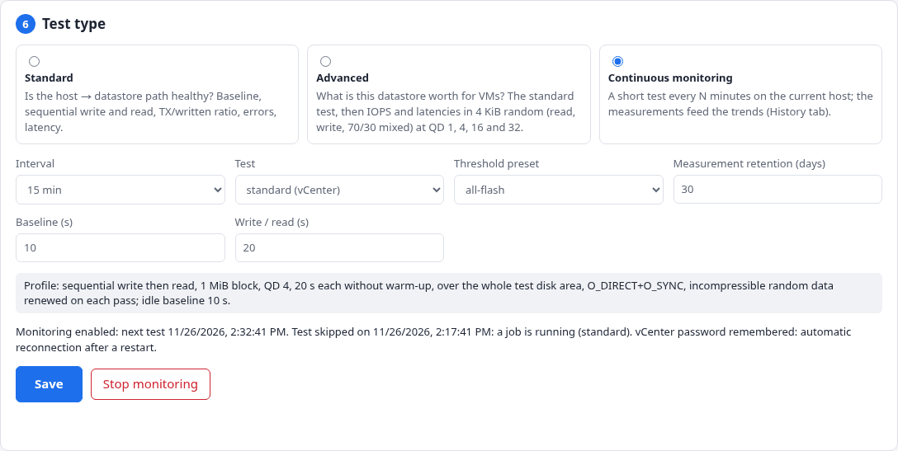

**Continuous monitoring** schedules a short test at a regular interval: see
[Monitoring and history](monitoring.md).

The **preset** (all-flash, hybrid, HDD) selects the verdict thresholds; they can be edited in
[Settings](settings.md#verdict-thresholds).

## 7. Execution

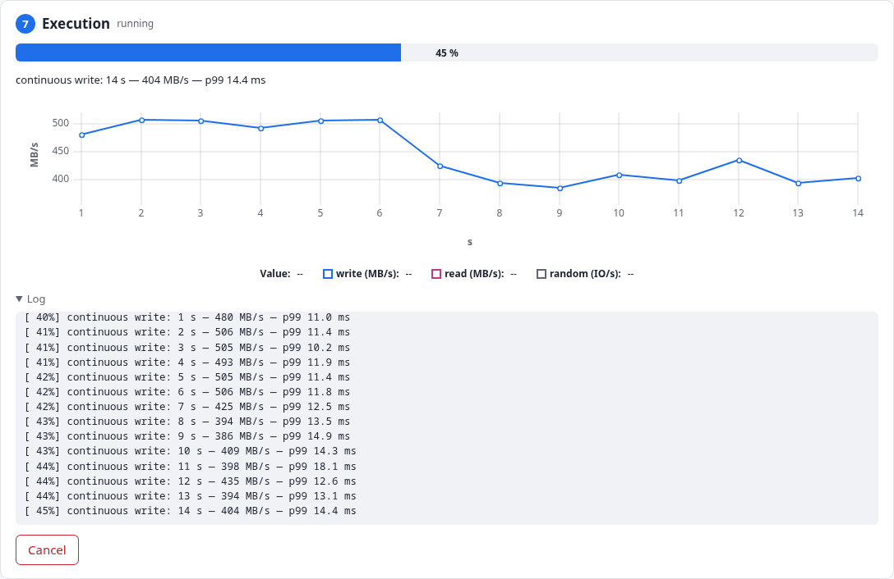

Progress, the current step, a live throughput chart (one point per second) and the job log. A test
can be cancelled at any time; the test disk is left in place.

## 8. Results

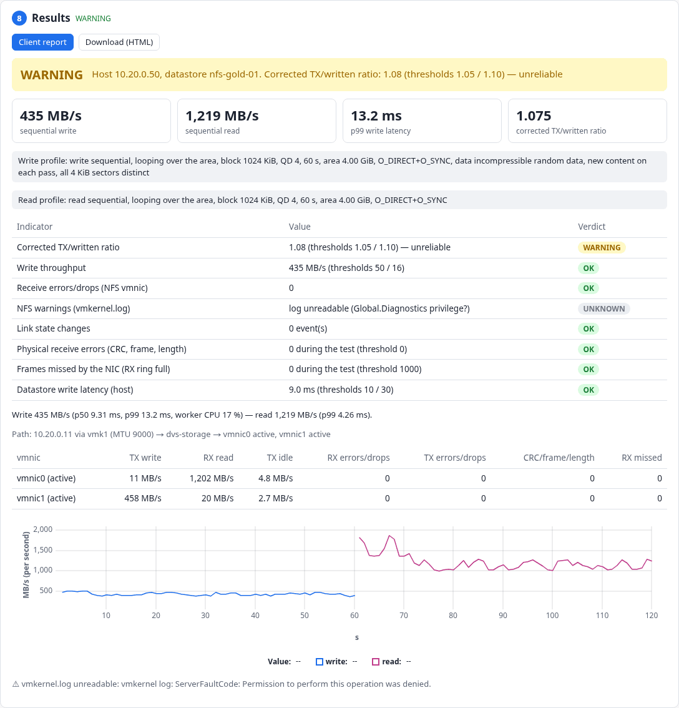

The verdict (OK, WARNING, ALERT, or UNKNOWN when an indicator could not be measured) is the worst of
the indicators:

| Indicator | What it detects |
|---|---|
| Corrected TX/written ratio | bytes sent by the host's NFS uplinks per byte written by the VM, after subtracting the idle baseline. Above 1.05–1.10, the host is retransmitting: packet loss on the NFS path |
| Write throughput | sequential write speed against the preset thresholds |
| Receive errors/drops (NFS vmnic) | errors and drops counted by vSphere on the uplinks during the test |
| NFS warnings (vmkernel.log) | NFS-related lines in the host log during the test (needs the Global.Diagnostics privilege) |
| Link state changes | uplink flaps during the test |
| Physical receive errors (CRC, frame, length) | detailed NIC counters read with `esxcli network nic stats get` through the API |
| Frames missed by the NIC | frames dropped because the NIC receive ring was full |
| Datastore write latency (host) | write latency of the datastore as seen by the host |

Below the indicators: the full I/O profile of each phase, the measured path, the per-vmnic traffic
(TX while writing, RX while reading, idle TX), and the throughput chart.

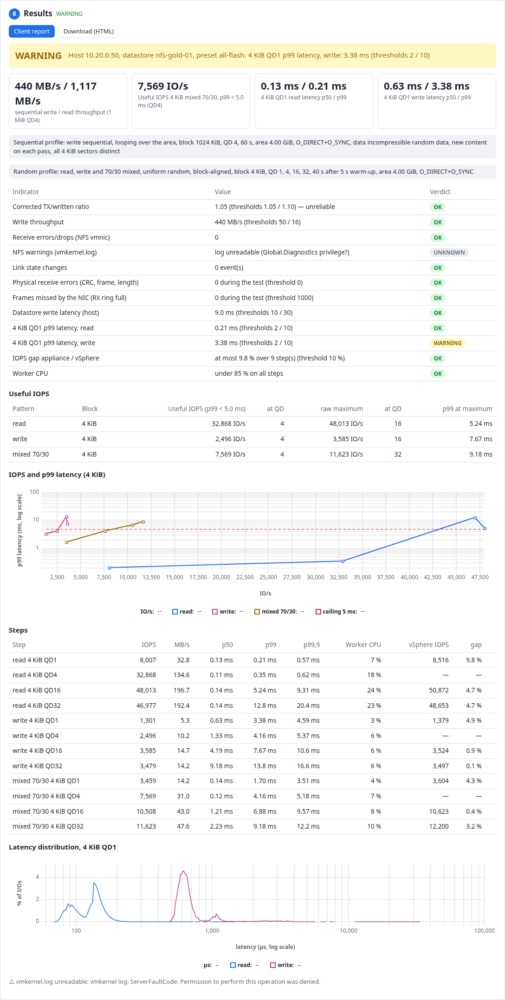

The advanced result adds the useful IOPS per pattern, an IOPS / p99 latency chart, every step of the
matrix cross-checked against the IOPS seen by vSphere, the worker CPU (a step above 85 % CPU is
limited by the appliance, not by the storage), and the QD1 latency distribution.

IOPS include the effect of the NFS server cache: this is what a VM sees, not a measurement of the
server's disks.

## Customer report

**Client report** opens a self-contained HTML report, printable on A4 (or saved as PDF), with the
branding set in [Settings](settings.md#report-branding). It opens offline: charts and fonts are
embedded. The report is in French.

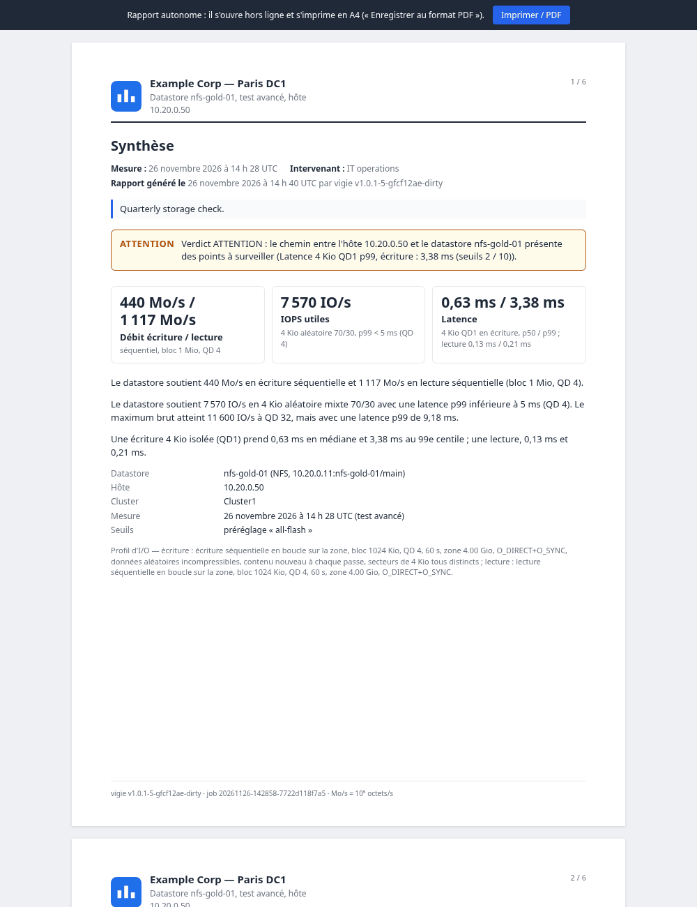

## 9. Cleanup

**Delete the test disk** detaches it from the VM and deletes its VMDK file. **Disconnect and forget
the URL** closes the vCenter session and clears the remembered URL and credentials.

## Without vCenter (local mode)

When the appliance has no vCenter access, the console *Storage* tab explains how to add a disk to the
VM by hand in the vSphere Client, then adopts that disk after strict checks (it appeared after the
request, it is blank, and you type its name back). Local tests measure throughput and latency without
the host counters. The appliance never removes or wipes that disk. See
[Appliance console](console.md#storage).

## What the appliance changes in vSphere

Only, and always on a user action: creating and deleting **its own** test disk, vMotion of **itself**,
and the optional DRS override on **itself** during a tour. Everything else is read-only; `esxcli`
is limited to an allowlist of read-only commands.
