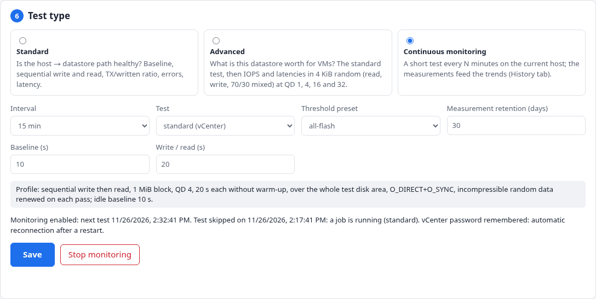
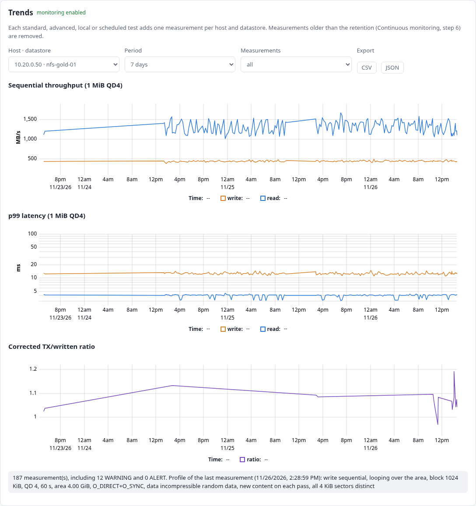
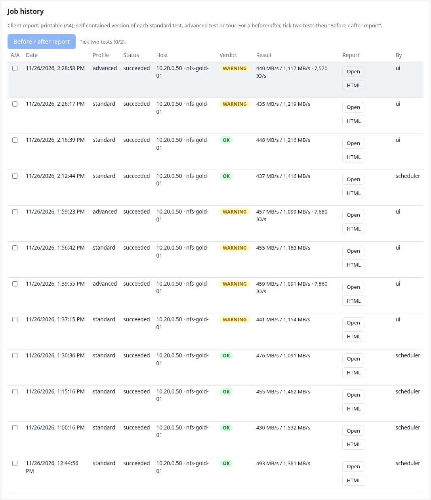
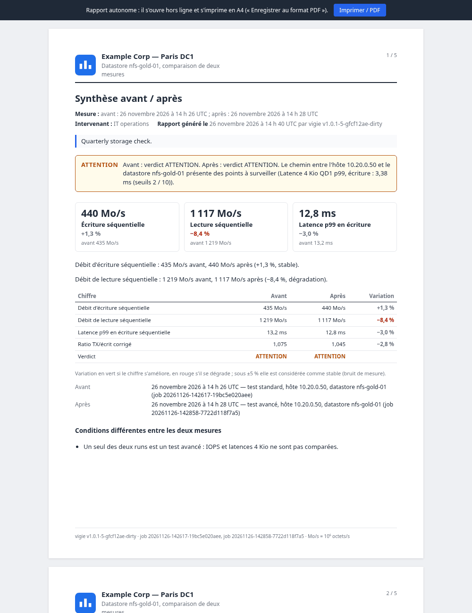

# Monitoring and history

## Continuous monitoring

In step 6 of the [Datastore performance](datastore.md) tab, **Continuous monitoring** runs a short
test on a schedule, every 15 minutes to 24 hours, on the host the appliance currently runs on:

- a *standard* test through vCenter (the vCenter password must be remembered), or a *local* test on a
  disk adopted from the console when there is no vCenter;
- every hour by default, with 30 s write and read phases and a 30 s baseline; shorter phases keep the
  load low (below 60 s of writing, the TX/written ratio is not measured); the profile line shows
  exactly what each run does;
- a run is skipped, with the reason shown, when another job is running, when vCenter is unreachable
  or when there is no test disk. If the vCenter session expired (vCenter restart), the appliance
  reconnects with the remembered password before the run.

Scheduled runs are kept apart from manual jobs (the last 96), and every measurement is also stored in
a compact history with a configurable retention (30 days by default).

## Trends

The **History** tab opens on the trends of one host and datastore over 24 hours, 7 or 30 days:

- sequential write and read throughput (1 MiB, QD 4);
- p99 latency, write and read, on a logarithmic scale;
- corrected TX/written ratio, when the write phase was long enough to measure it.

Measurements come from manual tests, scheduled tests, advanced tests and tour legs; the *Measurements*
filter keeps only scheduled ones or only manual ones. The summary below the charts counts the
warnings and alerts, and repeats the I/O profile of the last measurement.

**CSV** and **JSON** export the measurements of the period (also available through the API:
`GET /api/results?period=7d&format=csv`).

## Job history

Every job with its verdict, a short result, and who started it (the interface, the scheduler or an
API token). Click a row to see the full result again; **Open** or **HTML** gives the customer report
of a standard, advanced or tour job.

To compare two measurements, for example before and after a network change, tick two tests and
click **Before / after report**:

