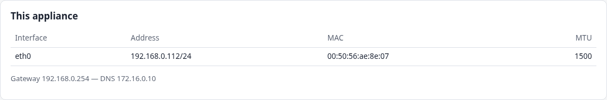
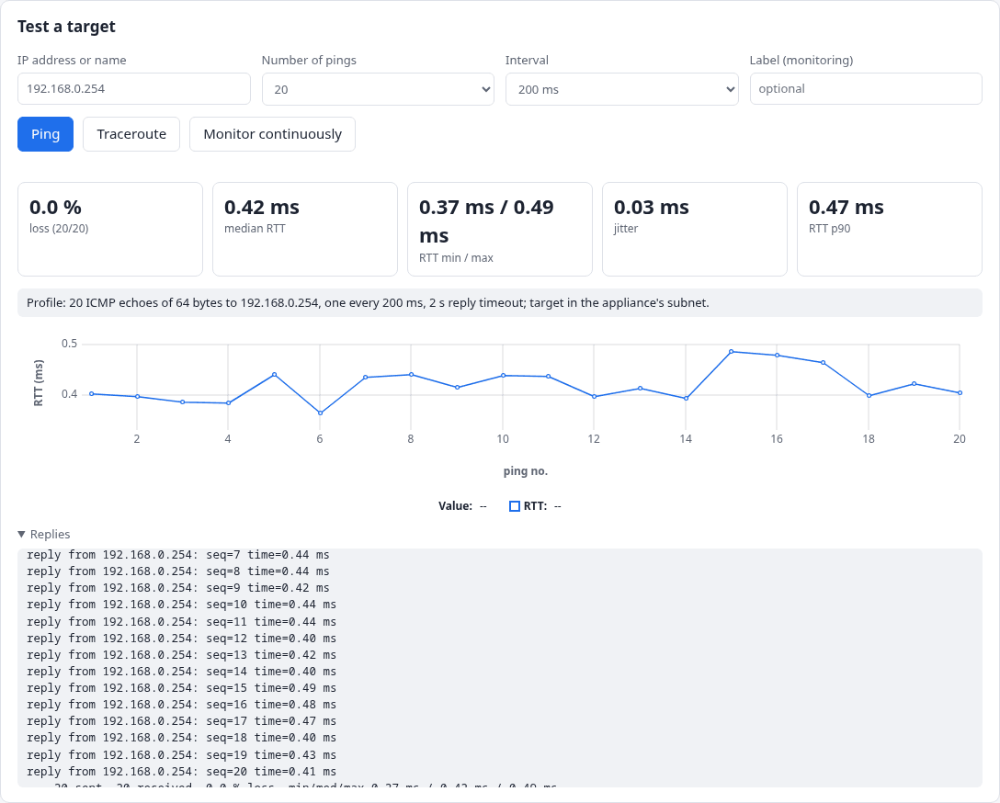
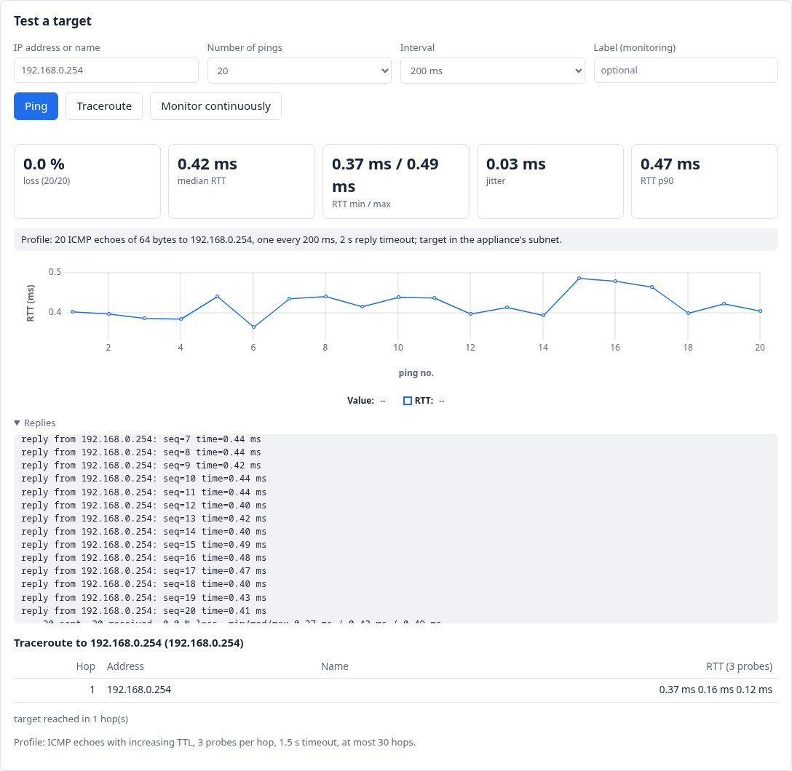
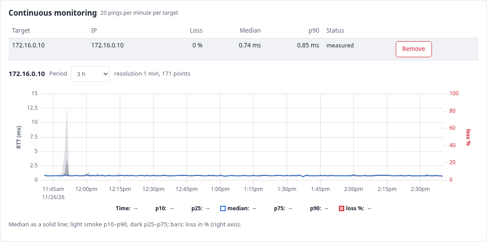
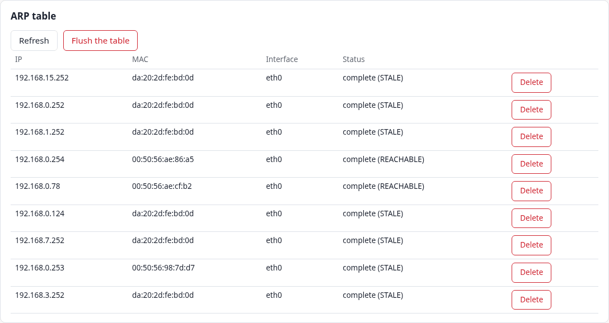
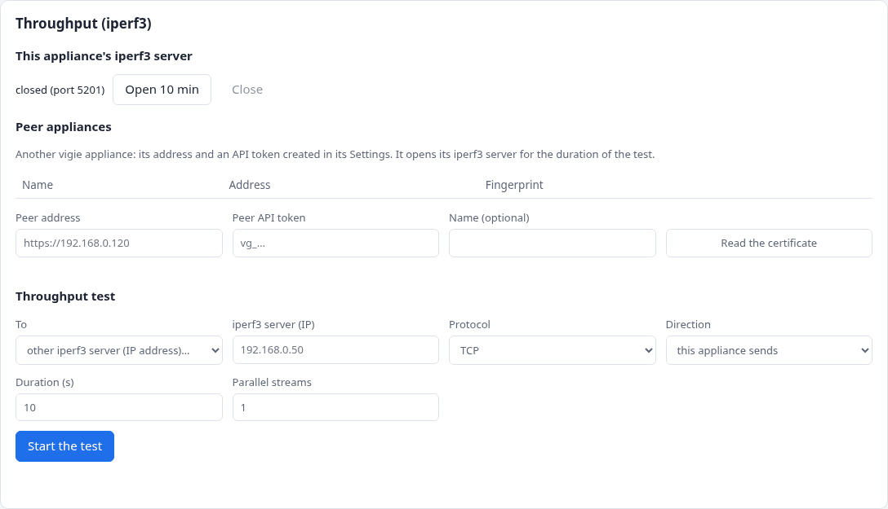

# Network diagnostics

The **Network** tab works without vCenter. Every tool runs from the appliance itself.

## Interfaces

Address, mask, MAC, MTU and link state of each appliance interface, with the default gateway and the
DNS servers. Network settings are changed from the [console](console.md#system).

## Ping and traceroute

Type an address or a name, choose the number of pings and the interval, then **Ping**: replies are
shown live, with loss, median RTT, min/max, jitter and p90, and an RTT chart. The profile line gives
the exact test (ICMP payload, interval, timeout, and whether the target is in the appliance subnet or
routed).

**Traceroute** shows each hop as soon as it answers (3 probes per hop, ICMP).

## Continuous target monitoring

**Monitor continuously** adds the target to a smokeping-style monitoring: 20 pings every minute,
kept for a year with decreasing resolution. Click a target to see its latency and loss over the last
hours, days or months; the shaded band shows the spread of the 20 pings of each minute.

## ARP table

The appliance neighbour table, refreshed on demand; **Flush** empties it, to check which device
answers for an address (duplicate IP, stale entry on a router).

## iperf3 between appliances

Throughput tests use iperf3 between two Vigie appliances, or towards any iperf3 server:

1. on the other appliance, create an API token (*Settings*);
2. here, add it as a **peer** with its URL and token, after confirming its certificate fingerprint;
3. pick the peer as the target: the appliance asks the peer to open its iperf3 server for the
   duration of the test, then runs the test (TCP or UDP, duration, parallel streams, reverse mode,
   target bitrate for UDP).

The result gives the throughput sent and received, TCP retransmissions, or jitter and loss for UDP,
with a per-second chart. To test against another server, start **iperf3 server** on one side and
type its address on the other.

Two appliances on two hosts of the same cluster are a simple way to test the VM network between
hosts, independently of the storage.

## Tools over SSH

`ssh root@<appliance-ip>` (with the appliance password) gives nmap, tcpdump, ethtool, smartctl,
ipmitool and iperf3.
