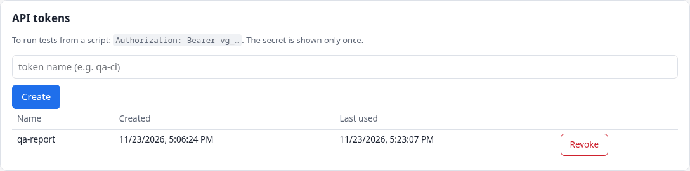
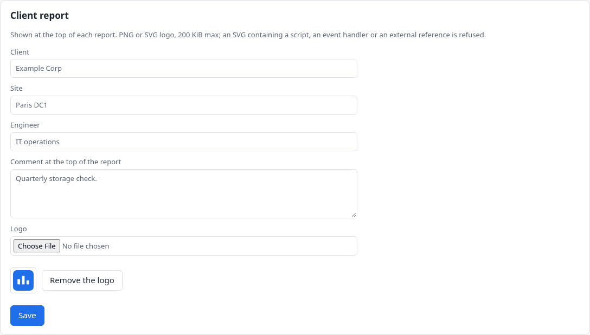
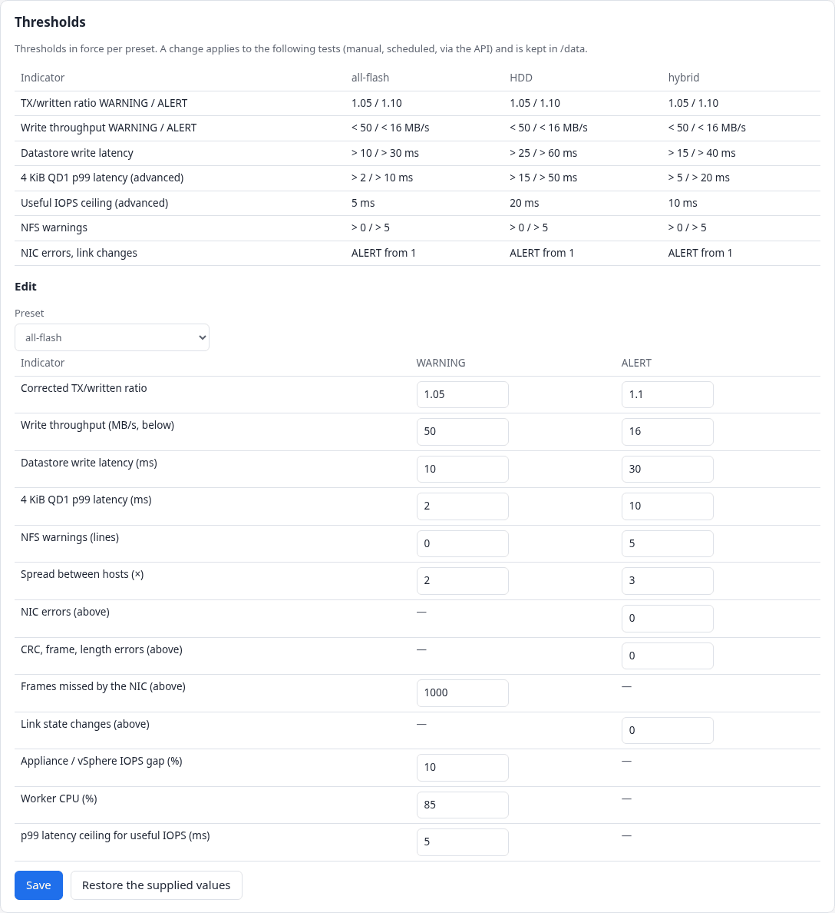
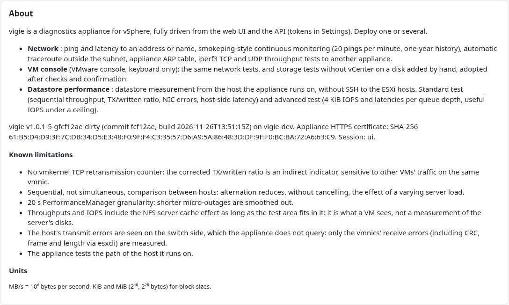

# Settings

## API tokens

The JSON API accepts `Authorization: Bearer vg_…` tokens. Create one per script or per peer
appliance; the secret is shown only once. A token can run tests and read everything, but cannot
create or revoke tokens. The job history shows which token started each job.

## Report branding

Customer name, site, author, a default comment and a logo (PNG or SVG, 200 KiB at most; SVG without scripts or external references), used
in the header of every [customer report](datastore.md#customer-report).

## Verdict thresholds

Each preset (all-flash, hybrid, HDD) has its WARNING and ALERT thresholds. Choose a preset, edit the
values, **Save**: the new thresholds apply to the next tests and are kept on the appliance disk.
**Restore the supplied values** brings back the built-in values of that preset.

Built-in values that differ between presets:

| Threshold | all-flash | hybrid | HDD |
|---|---|---|---|
| 4 KiB QD1 p99 latency, WARNING / ALERT | 2 / 10 ms | 5 / 20 ms | 15 / 50 ms |
| Datastore write latency (host), WARNING / ALERT | 10 / 30 ms | 15 / 40 ms | 25 / 60 ms |
| Latency ceiling for useful IOPS | 5 ms | 10 ms | 20 ms |

Common to all presets: TX/written ratio 1.05 / 1.10, write throughput below 50 / 16 MB/s, any vmnic
error, physical receive error or link change is an ALERT, more than 1000 frames missed by the NIC is a
WARNING, NFS warnings in vmkernel.log above 0 / 5 lines.

## About

A summary of the features, the version and build, the SHA-256 fingerprint of the appliance HTTPS
certificate (to compare with the one your browser shows), the known limitations and the units used
(MB/s = 10⁶ bytes per second; KiB and MiB for block sizes).
